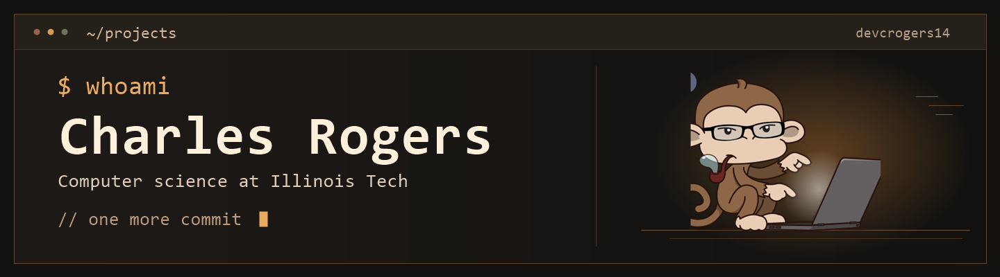

I’m a computer science student at Illinois Tech. I like to create little projects and have also experimented in GoDot.

## Projects

- **[Budgeteer 3000](https://github.com/devcrogers14/Budgeteer-3000)** — a team budgeting app with savings goals and spending charts.
- **Untitled 2D Game** — a Godot platformer with coins and slime enemies. Private repo.
